---
# 🧩 Versioning – systém dopĺňa automaticky
fm_version: "1.0.1"

# Dátum buildu – generuje skript
fm_build: "2026-11-23T17:30:52.696841+00:00"

# Poznámka k verzii – voliteľné
fm_version_comment: "Prototyp spoja (testovacia sada) – návrh v4 s plochými gumenými podložkami"

# 🆔 IDENTITY --------------------------------------------------------

# ID generuje CLI / skript
id: "K863004"

# Unikátne UUID – generuje skript
guid: "61402e00-8cac-4bd5-9f30-f1b2c02b84bf"

# 🧭 CONTEXT ---------------------------------------------------------

# DAO / doména (knife, sdlc, q12, 7ds...) dopĺňa skript
dao: "knife"

# Názov zápisu – dopĺňa používateľ
title: "K863004 – Teleskopická váza – od nápadu k prototypu spoja"

# Krátky popis – dopĺňa používateľ (voliteľné)
description: "Semestrálny projekt SMVIT – vodotesná teleskopická váza z 3D tlačiarne s bajonetovým zámkom. Štyri iterácie návrhu a testovacia sada na overenie zámku a tesnosti."

# 👥 AUTHORSHIP ------------------------------------------------------

# Hlavný autor – z globálneho configu
author: "Vojtech Babinský"

# Zoznam autorov – generuje skript
authors:
  - "Vojtech Babinský"

# 🗂 CLASSIFICATION ---------------------------------------------------

# Nadradená kategória – môže doplniť používateľ
category: "fablab"

# Typ dokumentu (guide, case, tutorial...) – používateľ (voliteľné)
type: "case-study"

# Priorita (low/medium/high) – voliteľné
priority: ""

# Tagy – odporúča sa 2–6 tagov.
# Typy tagov:
#   - rámce: knife, 7ds, sdlc, q12
#   - účel: tutorial, guide, pattern, case-study
#   - téma: git, backup, ai, communication
#   - úroveň: beginner, intermediate, advanced
tags:
  - knife
  - case-study
  - 3d-tlac
  - cad
  - fablab
  - intermediate

# 🌍 LOCALIZATION -----------------------------------------------------

# Jazyk dokumentu – doplní skript podľa štruktúry
locale: "sk"

# 🕒 LIFECYCLE --------------------------------------------------------

# Dátum vytvorenia – generuje skript
created: "2026-11-23 18:30"

# Dátum poslednej úpravy – dopĺňa človek
modified: "2026-11-23"

# Stav dokumentu – default "backlog"
status: "in-progress"

# Viditeľnosť – default "public"
privacy: "public"

# ⚖ INTELLECTUAL PROPERTY -------------------------------------------

# Držiteľ práv k obsahu – dopĺňa skript
rights_holder_content: "Vojtech Babinský"

# Systémový vlastník práv
rights_holder_system: "CAA / KNIFE / LetItGrow"

# Licencia
license: "CC-BY-NC-SA-4.0"

# Disclaimer
disclaimer: "Use at your own risk. Methods provided as-is; participation is voluntary and context-aware."

# Copyright
copyright: "© 2026 Vojtech Babinský"

# 🔗 ORIGIN / PROVENANCE ---------------------------------------------

# Repozitár pôvodu
origin_repo: ""

# URL pôvodného repozitára
origin_repo_url: ""

# Commit pôvodu
origin_commit: ""

# Branch pôvodu
origin_branch: ""

# Systém pôvodu (CAA/KNIFE/STHDF…)
origin_system: "CAA"

# Pôvodný autor
origin_author: "Vojtech Babinský"

# Importovaný zdroj
origin_imported_from: ""

# Dátum importu
origin_import_date: ""

# 🧱 RESERVED ---------------------------------------------------------

fm_reserved1: ""
fm_reserved2: ""
---

# 🏺 Teleskopická váza – od nápadu k prototypu spoja

## 🎯 Čo rieši (účel, cieľ)

Bežná váza má jednu pevnú výšku a pri skladovaní zaberá zbytočne veľa
miesta. Cieľom semestrálneho projektu je **malá, ale plne funkčná váza
z 3D tlačiarne**, ktorá sa dá vysunúť a zasunúť ako ďalekohľad, vo
vysunutej polohe sa pevne zamkne a **nepreteká**.

Požiadavky, ako postupne vznikali:

- teleskopická konštrukcia z troch segmentov,
- zaistenie segmentov **bajonetovým zámkom**,
- gumové tesnenie,
- vysunutá výška **najviac 20 cm**,
- vnútorný priemer najväčšieho segmentu **najviac 10 cm**,
- **najširší segment hore** (obrátená architektúra),
- dekorácia: **presne 9 srdiečok** na vrchnom segmente.

Tento zápis popisuje cestu od prvého nápadu cez štyri verzie návrhu až po
**testovací prototyp spoja**, na ktorom sa pred tlačou celej vázy overí,
či sa bajonet dá zamknúť a či spoj tesní.

## 🧩 Ako to rieši (princíp)

Váza má tri segmenty: **spodok** (najužší, s dnom a pätkou), **stred**
a **vrch** (najširší). Každý vyšší segment sa nasúva zvonka na nižší.
Spoj medzi dvoma segmentmi tvoria tri prvky:

- **Krúžok so závitom** sa zaskrutkuje do vrchu nižšieho segmentu. Má
  3 kolíky a nad nimi plnú prírubu. Závit sa utesní teflónovou páskou.
- **Golier** na spodku vyššieho segmentu má tri L-drážky. Kolíky do nich
  vojdú zhora, segment sa pootočí o 30° a zamkne.
- **Plochá gumená podložka** leží v lôžku pod prírubou krúžku. Strop
  L-drážky pri otáčaní mierne klesá, takže kolík pritiahne golier
  k prírube a podložku stlačí o 25 %. Tesne pred koncom je 0,3 mm
  poistka proti samovoľnému odkrúteniu.

Kľúčová myšlienka: **pri vysúvaní nič netesní**, golier sa po stene len
posúva s vôľou. Tesnosť vznikne až po zamknutí, keď sa stlačí podložka.

Model je **parametrický** (OpenSCAD). Všetky rozmery sú premenné a sú
od seba odvodené, takže zmena jedného čísla (napríklad hrúbky gumy)
prepočíta lôžko, drážky aj výšky.

## 🧪 Ako to použiť (aplikácia)

1. Vytlačiť **testovaciu sadu** (3 diely, skrátený spoj spodok/stred).
2. Vyrezať jednu gumenú podložku podľa šablóny, na závit dať teflónovú pásku.
3. Zložiť, zamknúť, naplniť vodou a nechať stáť na papierovej utierke.
4. Podľa výsledku doladiť parametre (vôľa `clr`, hrúbka gumy `gasket_t`).
5. Až potom tlačiť celú vázu.

---

## ⚡ Rýchly návod (Top)

| Čo | Hodnota |
|---|---|
| 📏 Výška vysunutá / zložená | 192 mm / 86 mm |
| ⭕ Vonkajší priemer spodok / stred / vrch | 58 / 80,8 / 103,6 mm |
| 🫙 Vnútorný priemer vrchu | 98,8 mm (limit 100) |
| 🔒 Bajonet | 3 kolíky, pootočenie 30°, poistka 0,3 mm |
| ⚫ Tesnenie | plochá guma 2 mm, stlačenie 25 %, závit teflónová páska |
| 🧪 Prototyp | test_lower + ring_bottom + test_upper + 1 podložka |
| 🧵 Materiál | PETG, 4 perimetre |
| ❤️ Dekorácia | 9 srdiečok (reliéf 1,5 mm), natreté akrylom |
| 🛠️ Nástroje | OpenSCAD (model), PrusaSlicer (tlač), Tinkercad (drobné úpravy) |

## 📜 Detailný článok

### 1. Nápad a prvý koncept

Pôvodný nápad: niekoľko rúrok, ktoré sa zasúvajú do seba a zaisťujú
bajonetom, s O-krúžkami ako tesnením. Hneď na začiatku sa ukázal prvý
konflikt. Ak by boli bajonetové drážky vyrezané priamo v stene segmentu,
kolíky by po nich museli prejsť celou dĺžkou a drážka by **prerušila
plochu, o ktorú tesní O-krúžok**.

Riešenie, ktoré prežilo všetky ďalšie verzie: bajonet patrí do
**samostatného krúžku** naskrutkovaného na segment.

### 2. Návrh v1 – krúžok zvonka

Krúžok s L-drážkami sa naskrutkoval zvonka na vonkajší závit segmentu.
Funkčne to sedelo, ale krúžok bol širší ako segment a vytŕčal. Vysunutá
váza mala asi 287 mm.

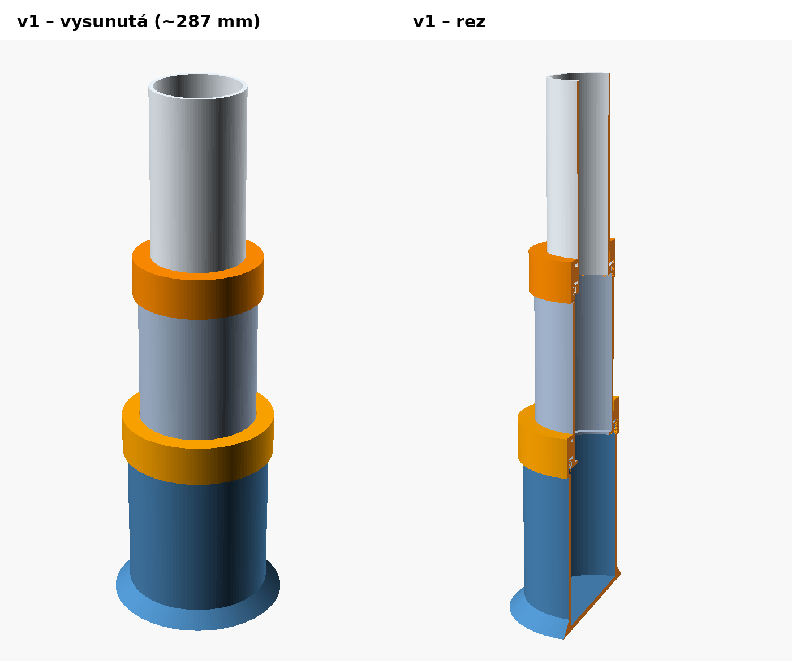

### 3. Spätná väzba – „prečo je tam ten krúžok?“

Pri kontrole vznikla otázka, či krúžok nie je zbytočný a nemôže byť
súčasťou segmentu.

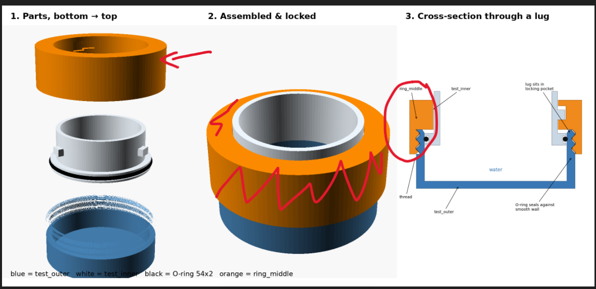

Odpoveď je v montáži: príruba krúžku presahuje nad golier vnútorného
segmentu. Keby bola pevnou súčasťou vonkajšieho dielu, vnútorný segment
by sa doň nedal vložiť (zhora nie, golier je širší ako otvor; zdola nie,
spodok má dno). Krúžok teda zostal, ale zmenil tvar podľa nákresu:

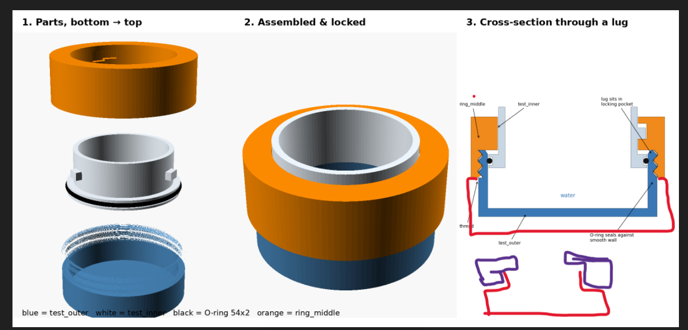

### 4. Návrh v2 – krúžok zarovno, limit 20 cm

Krúžok už neobopína segment, ale sedí navrchu s rovnakým priemerom a jeho
čap so závitom sa zaskrutkuje dovnútra steny. Vedľajší efekt: váza sa
zloží úplne až na dno. Prvá **testovacia sada** (krátky spoj s dnom) mala
overiť tesnosť za zlomok materiálu.

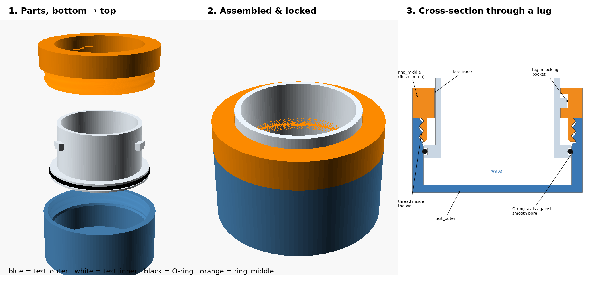

Po požiadavke na maximálnu výšku 20 cm stačilo zmeniť dva parametre:
192 mm vysunutá, 87 mm zložená.

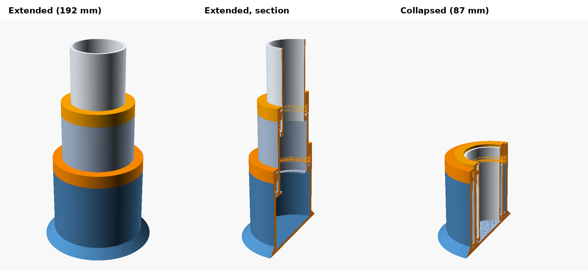

### 5. Návrh v3 – obrátená váza, O-krúžky 78×3 a 90×3

Nové požiadavky: vnútorný priemer najväčšieho segmentu najviac 10 cm
a **najširší segment hore**. Obrátenie zmenilo celý spoj: vyšší segment
sa teraz nasúva **zvonka** na nižší. O-krúžok sa presunul do vnútornej
drážky golieru a tesnil o hladkú vonkajšiu stenu nižšieho segmentu.
Kolíky sa presunuli na krúžok, L-drážky do golieru.

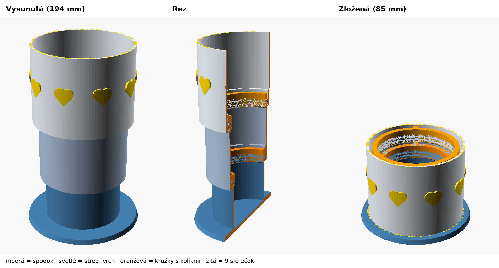

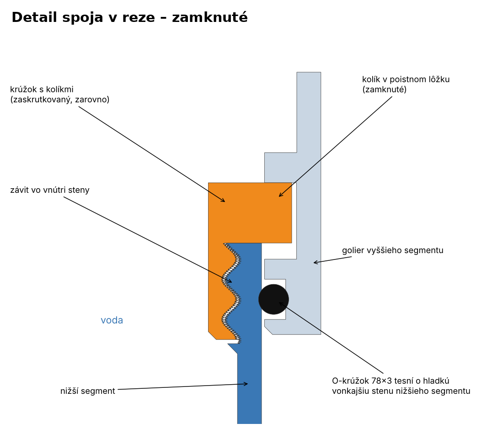

Vybrali sa štandardné NBR O-krúžky 78×3 a 90×3 (prierez 3 mm lepšie znáša
nepresnosti 3D tlače). Riešila sa aj možnosť zmenšiť väčší krúžok
rozrezaním a zlepením (súpravy na lepenie O-krúžkov).

### 6. Návrh v4 – ploché gumené podložky

Zásadná zmena koncepcie: **vodotesnosť je potrebná iba po zamknutí, nie
počas pohybu.** O-krúžok, ktorý sa pri vysúvaní trie o stenu, je teda
zbytočný. Nahradila ho **plochá gumená podložka**, ktorú stlačí až
bajonet.

Pri obrátenej architektúre sa to nedalo spraviť len výmenou tesnenia.
Vyšší segment sa pri zložení zasúva cez celý nižší, takže nesmie mať
žiadnu plôšku presahujúcu dovnútra. Podložka preto leží v lôžku pod
**prírubou krúžku** a strop L-drážky klesá tak, aby kolík pritiahol
golier k prírube.

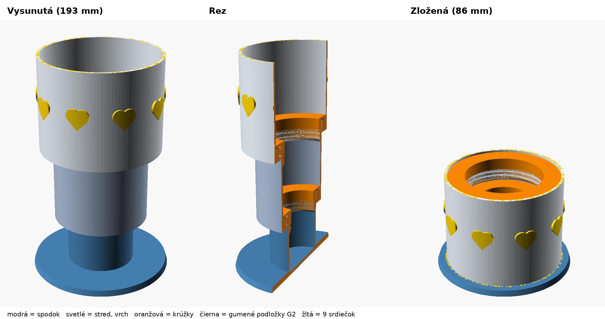

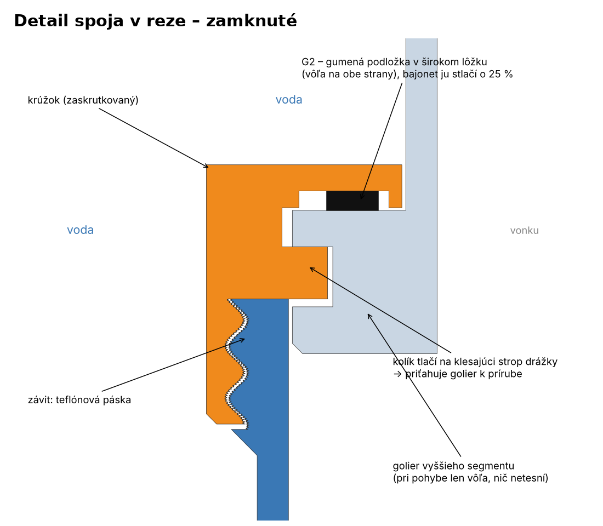

Prvá verzia v4 mala aj druhú podložku pod krúžkom (na utesnenie závitu).
Ukázala sa ako nevyrezateľná rukou (šírka 2,3 mm), preto ju nahradila
**teflónová páska**. Zároveň sa **uvoľnili tolerancie podložky**: lôžko je
široké asi 7 mm a podložka môže mať vonkajší priemer v rozsahu niekoľkých
milimetrov. Tesní tlakom zhora, nie presným obvodom, takže sa dá vyrezať
nožom podľa vytlačenej šablóny. Hĺbka lôžka sa dopočítava z nameranej
hrúbky gumy, takže funguje 2 mm guma aj 1 mm duša z bicykla.

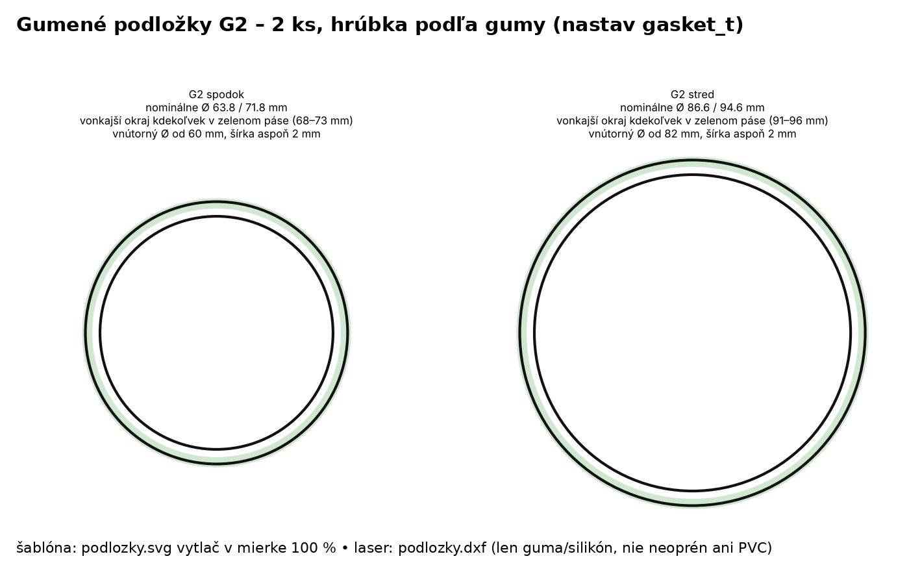

### 7. Dekorácia a farby

Z viacerých motívov zostal jediný: **presne 9 srdiečok** po 40° ako
reliéf 1,5 mm na vrchnom segmente (počet overený rezom modelu).

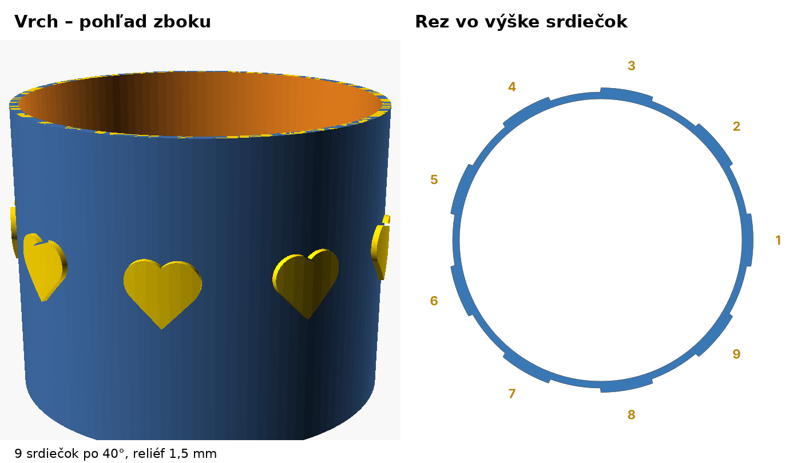

Porovnali sa farebné varianty (napr. čierna alebo svetloružová váza
s červenými srdiečkami).

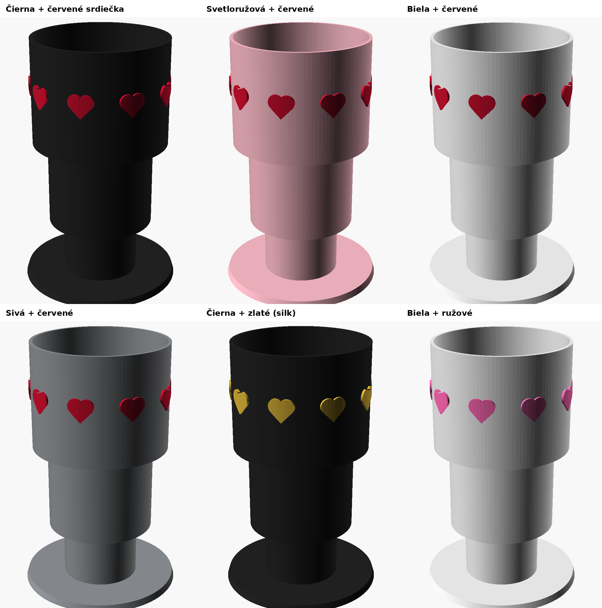

Srdiečka sú v rovnakých vrstvách ako stena, preto by viacfarebná tlač
znamenala dve výmeny filamentu v každej vrstve (hodiny navyše a desiatky
gramov odpadu z prečisťovania). Rozhodnutie: **tlačiť jednofarebne
a srdiečka natrieť** akrylovou fixkou, potom prelakovať.

### 8. Prototyp spoja – testovacia sada

Pred tlačou celej vázy sa vytlačí iba skrátený spoj spodok/stred. Má
rovnaké priemery, bajonet, závit aj lôžko ako celá váza:

- **test_lower** – krátky spodok s dnom a vnútorným závitom (Ø 58, výška 25 mm),
- **ring_bottom** – krúžok s kolíkmi a prírubou (rovnaký ako na váze),
- **test_upper** – krátky stred s golierom a L-drážkami (Ø 81, výška 46 mm),
  zvýšený tak, aby voda stála 25 mm nad spojom.

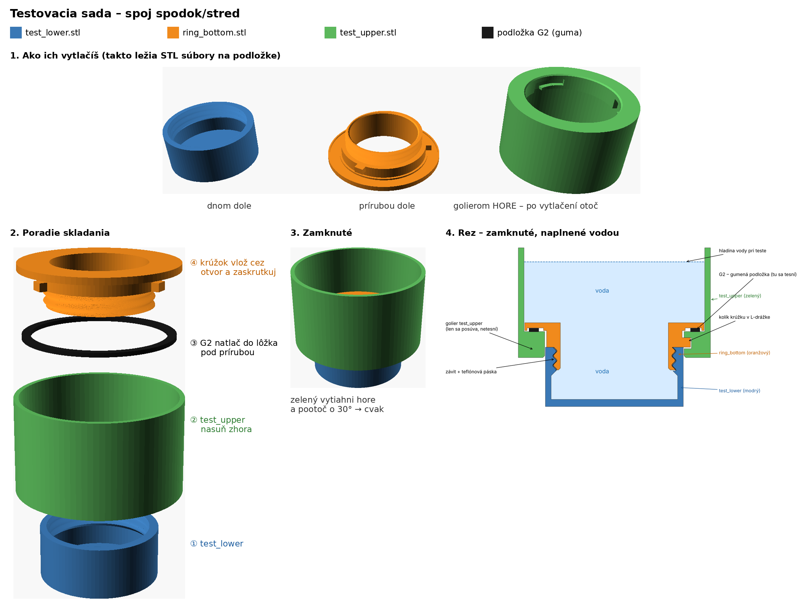

Pred odovzdaním na tlač prešiel model kontrolou: výpočtom všetkých vôlí
a **kolíznym testom geometrie** (prienik objemov dielov v zamknutej
polohe a po 1° počas celého pootočenia bajonetu). Kontrola našla dve
chyby:

1. **Poistka sa nedala prepnúť.** Pri prechode poistky sa golier musí
   zdvihnúť o 0,3 mm, ale medzi golierom a prírubou bola vôľa iba 0,2 mm.
   Plast by narazil na plast po celom obvode. Oprava: vôľa 0,4 mm,
   stlačenie podložky zostalo 25 %, do modelu pribudla automatická
   kontrola (`assert`).
2. **Zlá orientácia na tlač.** Strop L-drážky (o ktorý sa opiera kolík
   a na ktorom je poistka) by pri tlači postojačky visel ako 3 mm previs.
   Oprava: segmenty s golierom sa tlačia hore nohami, krúžky prírubou
   dole s podperami len pod kolíkmi. STL sú exportované rovno v polohe
   na tlač.

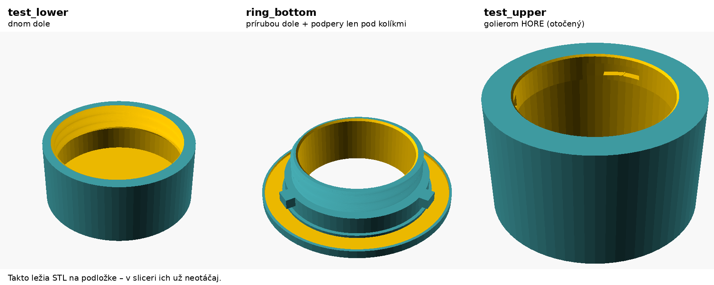

Postup testu: teflónová páska na závit krúžku → test_upper nasunúť na
test_lower → podložku do lôžka krúžku → krúžok vložiť cez otvor
a zaskrutkovať → test_upper vytiahnuť hore a pootočiť o 30° → naplniť
vodou a nechať niekoľko hodín na papierovej utierke. Podľa miesta, kde
utierka zvlhne, sa dá určiť príčina (podložka, závit, alebo pórovitá
stena výtlačku).

#### Súbory

Umiestnenie v repozitári: `content/docs/assets/project/prototyp-v4/`

- `teleskopicka_vaza.scad` – parametrický model v4,
- `stl/test_lower.stl`, `stl/ring_bottom.stl`, `stl/test_upper.stl` –
  testovacia sada v polohe na tlač,
- `podlozky.svg` – šablóna na vyrezanie gumených podložiek.

### Prehľad iterácií

| Verzia | Zmena | Dôvod |
|---|---|---|
| koncept | bajonet v samostatnom krúžku | drážka v stene by prerušila tesnenie |
| v1 | krúžok zvonka na vonkajšom závite | jednoduchá montáž |
| v2 | krúžok zarovno, závit vo vnútri steny | vzhľad, úplné zloženie |
| v2.1 | výšky 72 / 72 / 80 mm | limit 200 mm |
| v3 | obrátená váza, O-krúžky 78×3 a 90×3 | najširší segment hore, ID ≤ 100 mm |
| v4 | ploché podložky stlačené bajonetom | tesnosť treba len po zamknutí |
| v4.1 | bez podložky pod závitom, voľné tolerancie | ručné rezanie podložiek |
| v4.2 | 9 srdiečok, natieranie namiesto viacfarebnej tlače | čas, odpad, jednoduchosť |
| v4.3 | vôľa 0,4 mm, diely otočené na tlač | chyby nájdené kolíznym testom |

## 💡 Tipy a poznámky

- **Najprv testovacia sada, potom celá váza.** Spoj sa overí na zlomku
  materiálu a času.
- **Kontroluj model geometricky, nie len vizuálne.** Obe chyby v poslednej
  iterácii boli na obrázkoch neviditeľné (0,1 mm presah, previs vo vnútri
  drážky).
- **Myslieť na orientáciu tlače už pri návrhu** – funkčná plocha nesmie
  byť previs.
- **Tesniť tam, kde netreba presnosť.** Plochá podložka stlačená zhora
  znesie chybu rezu 1–2 mm, O-krúžok v drážke nie.
- **Hrúbku gumy nameraj** a prepíš parameter `gasket_t`, lôžko sa prepočíta.
- **Krúžok dotiahni pevne na doraz.** Odomykanie ho ťahá v smere
  povoľovania závitu; ak by sa pri teste odkrúcal, treba doplniť zarážku.
- PETG namiesto PLA (lepšie znáša vodu), aspoň 4 perimetre. Ak stena
  presakuje, pridať perimetre alebo prietok.
- Na laseri vo FabLabe len guma/silikón, **nie neoprén ani PVC** (chlór).

## ✅ Hodnota / Zhrnutie

Projekt prešiel celým cyklom digitálnej výroby: požiadavky → parametrický
CAD model → iterácie podľa spätnej väzby → overenie výpočtom a kolíznym
testom → testovací prototyp. Každá veľká zmena (obrátenie vázy, ploché
podložky) prepísala celý spoj, nie len jeden diel – tesnosť, montáž,
skladanie, vzhľad a tlačiteľnosť sa navzájom ovplyvňujú. To je jadro
systémového myslenia, ktoré predmet sleduje.

Z pohľadu životného cyklu (M7): vymeniteľné podložky a rozoberateľný spoj
predlžujú životnosť, testovacia sada šetrí materiál na prototypy
a natieranie srdiečok namiesto viacfarebnej tlače eliminuje odpad
z prečisťovania.

**Ďalšie kroky:** vytlačiť a otestovať prototyp spoja, zapísať výsledky
testu tesnosti, doladiť parametre, vytlačiť celú vázu a natrieť srdiečka.

<!-- body:start -->

<!-- nav:knifes -->
> [⬅ KNIFES – Prehľad](../knifes_overview/KNIFE_Overview_Blog.md) • [Zoznam](../knifes_overview/KNIFE_Overview_List.md) • [Detaily](../knifes_overview/KNIFE_Overview_Details.md)
---
