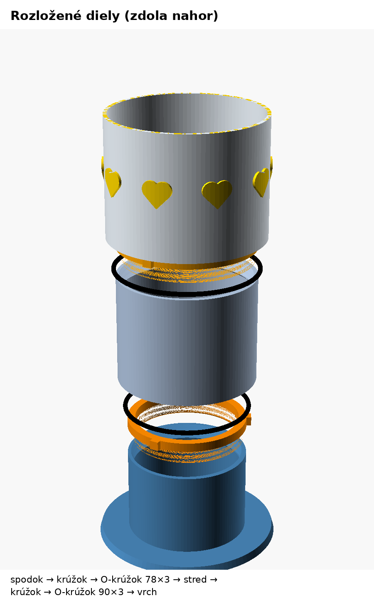
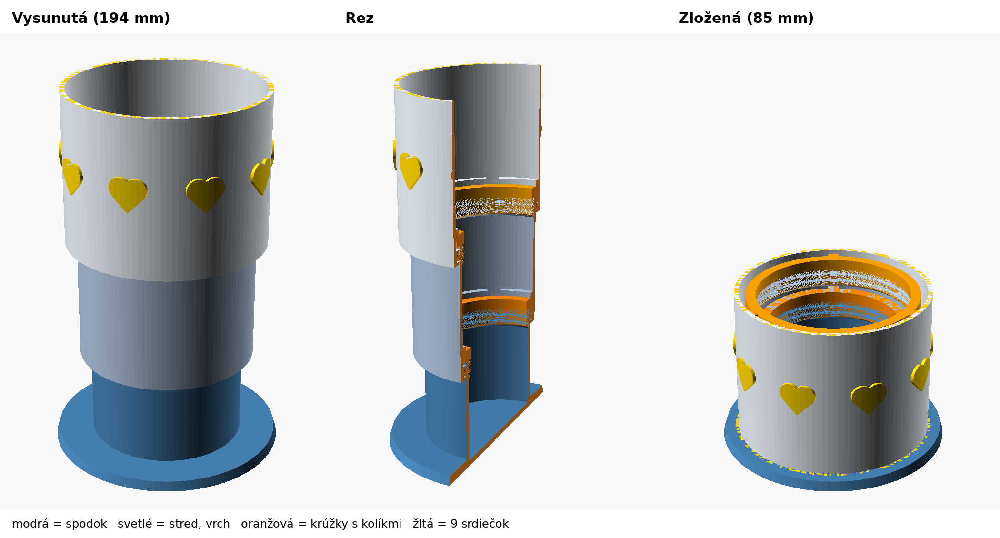
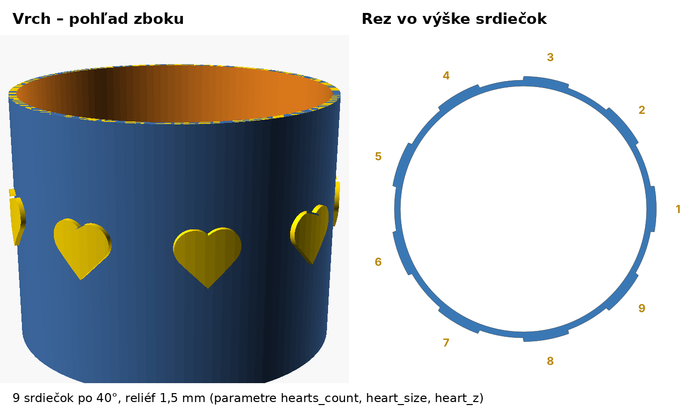

---
# 🧩 Versioning – systém dopĺňa automaticky
fm_version: "1.0.1"

# Dátum buildu – generuje skript
fm_build: "2026-10-20T13:28:02.084386+00:00"

# Poznámka k verzii – voliteľné
fm_version_comment: ""

# 🆔 IDENTITY --------------------------------------------------------

# ID generuje CLI / skript

# Unikátne UUID – generuje skript
guid: "e333e0fd-3480-49b5-b7e8-bc0601b382a2"

# 🧭 CONTEXT ---------------------------------------------------------

# DAO / doména (knife, sdlc, q12, 7ds...) dopĺňa skript
dao: "sthdf"

# Názov zápisu – dopĺňa používateľ
title: "04.D4 Design"

# Krátky popis – dopĺňa používateľ (voliteľné)
description: "{{DESCRIPTION}}"

# 👥 AUTHORSHIP ------------------------------------------------------

# Hlavný autor – z globálneho configu
author: "Vojtech Babinský"

# Zoznam autorov – generuje skript
authors:
  - "Vojtech Babinský"

# 🗂 CLASSIFICATION ---------------------------------------------------

# Nadradená kategória – môže doplniť používateľ
category: ""

# Typ dokumentu (guide, case, tutorial...) – používateľ (voliteľné)
type: ""

# Priorita (low/medium/high) – voliteľné
priority: ""

# Tagy – odporúča sa 2–6 tagov.
# Typy tagov:
#   - rámce: knife, 7ds, sdlc, q12
#   - účel: tutorial, guide, pattern, case-study
#   - téma: git, backup, ai, communication
#   - úroveň: beginner, intermediate, advanced
tags: []

# 🌍 LOCALIZATION -----------------------------------------------------

# Jazyk dokumentu – doplní skript podľa štruktúry
locale: "sk"

# 🕒 LIFECYCLE --------------------------------------------------------

# Dátum vytvorenia – generuje skript
created: "2026-10-20 15:28"

# Dátum poslednej úpravy – dopĺňa človek
modified: "2026-11-23 18:30"

# Stav dokumentu – default "backlog"
status: "in-progress"

# Viditeľnosť – default "public"
privacy: "public"

# ⚖ INTELLECTUAL PROPERTY -------------------------------------------

# Držiteľ práv k obsahu – dopĺňa skript
rights_holder_content: "Vojtech Babinský"

# Systémový vlastník práv
rights_holder_system: "CAA / KNIFE / LetItGrow"

# Licencia
license: "CC-BY-NC-SA-4.0"

# Disclaimer
disclaimer: "Use at your own risk. Methods provided as-is; participation is voluntary and context-aware."

# Copyright
copyright: "© 2026 Vojtech Babinský"

# 🔗 ORIGIN / PROVENANCE ---------------------------------------------

# Repozitár pôvodu
origin_repo: ""

# URL pôvodného repozitára
origin_repo_url: ""

# Commit pôvodu
origin_commit: ""

# Branch pôvodu
origin_branch: ""

# Systém pôvodu (CAA/KNIFE/STHDF…)
origin_system: "CAA"

# Pôvodný autor
origin_author: "Vojtech Babinský"

# Importovaný zdroj
origin_imported_from: ""

# Dátum importu
origin_import_date: ""

# 🧱 RESERVED ---------------------------------------------------------

fm_reserved1: ""
fm_reserved2: ""
---

<!-- SDLC_INSTANCE_ID: ST-863-VojtechBabinsky -->

# D4 – Design

Detailný popis návrhu a všetkých iterácií je v
[K863001 – Teleskopická váza](../../../../../knifes/K863001-projekt/index.md). Tu je zhrnutie finálnej verzie **v3**.

## 🏗️ Architektúra

Tri segmenty (spodok s pätkou, stred, vrch) a dva krúžky so závitom.
**Najväčší segment je hore** – vyšší segment sa nasúva zvonka na nižší.

## 📏 Rozmery

| Diel | Rozmer |
| ---- | ------ |
| Vrch (najväčší) | vnútorný priemer 98,8 mm |
| Stred | vonkajší priemer 91,8 mm |
| Spodok | vonkajší priemer 80 mm |
| Pätka | priemer 120 mm |
| Výška | 194 mm vysunutá, 85 mm zložená |

## 🔒 Spoj segmentov

- **Tesnenie** – O-krúžok vo vnútornej drážke golieru vyššieho segmentu
  tesní o hladkú vonkajšiu stenu nižšieho segmentu.
- **Bajonet** – 3 kolíky po 120° na krúžku, ktorý sa zaskrutkuje do
  vrchu nižšieho segmentu. L-drážky v golieri nad O-krúžkom, pootočenie
  o 30°, poistka 1 mm.
- L-drážky sú **otvorené smerom hore** – tesniacu plochu neprerušia.

## 💛 Dekorácia

Reliéf 1,5 mm na vrchnom segmente, motív sa volí parametrom `motif`
(`mix`, `kvet`, `srdce`, `hviezda`, `ziadna` alebo vlastné `svg`).
Stred a spodok sa reliéfom dekorovať nedajú, lebo po nich kĺže O-krúžok.

## 🔄 Iterácie

| Verzia | Zmena |
| ------ | ----- |
| v1 | krúžok zvonka na vonkajšom závite |
| v2 | krúžok zarovno, závit vo vnútri steny, výška 192 mm |
| v3 | obrátená architektúra, vonkajšie tesnenie, O-krúžky 3 mm, reliéf |

Dôvody jednotlivých zmien: [Decisions](../01.D1-Management/04.Decisions/index.md)

**Navigation:** [⬆️ Up](../index.md) · [🏠 Home](../index.md)
