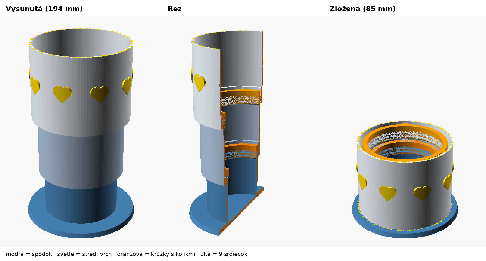

---
# 🧩 Versioning – systém dopĺňa automaticky
fm_version: "1.0.1"

# Dátum buildu – generuje skript
fm_build: "2026-10-20T13:28:07.628160+00:00"

# Poznámka k verzii – voliteľné
fm_version_comment: ""

# 🆔 IDENTITY --------------------------------------------------------

# ID generuje CLI / skript

# Unikátne UUID – generuje skript
guid: "c75eb849-2b15-48bd-a651-5e262d73081b"

# 🧭 CONTEXT ---------------------------------------------------------

# DAO / doména (knife, sdlc, q12, 7ds...) dopĺňa skript
dao: "sthdf"

# Názov zápisu – dopĺňa používateľ
title: "Pitch Presentation – Teleskopická váza"

# Krátky popis – dopĺňa používateľ (voliteľné)
description: "Pitch teleskopickej vázy z 3D tlače – problém, riešenie, hodnota, biznis model, tím a call to action."

# 👥 AUTHORSHIP ------------------------------------------------------

# Hlavný autor – z globálneho configu
author: "Vojtech Babinský"

# Zoznam autorov – generuje skript
authors:
  - "Vojtech Babinský"

# 🗂 CLASSIFICATION ---------------------------------------------------

# Nadradená kategória – môže doplniť používateľ
category: ""

# Typ dokumentu (guide, case, tutorial...) – používateľ (voliteľné)
type: ""

# Priorita (low/medium/high) – voliteľné
priority: ""

# Tagy – odporúča sa 2–6 tagov.
# Typy tagov:
#   - rámce: knife, 7ds, sdlc, q12
#   - účel: tutorial, guide, pattern, case-study
#   - téma: git, backup, ai, communication
#   - úroveň: beginner, intermediate, advanced
tags:
  - sthdf
  - pitch
  - 3d-tlac
  - fablab

# 🌍 LOCALIZATION -----------------------------------------------------

# Jazyk dokumentu – doplní skript podľa štruktúry
locale: "sk"

# 🕒 LIFECYCLE --------------------------------------------------------

# Dátum vytvorenia – generuje skript
created: "2026-10-20 15:28"

# Dátum poslednej úpravy – dopĺňa človek
modified: "2026-11-23 17:00"

# Stav dokumentu – default "backlog"
status: "in-progress"

# Viditeľnosť – default "public"
privacy: "public"

# ⚖ INTELLECTUAL PROPERTY -------------------------------------------

# Držiteľ práv k obsahu – dopĺňa skript
rights_holder_content: "Vojtech Babinský"

# Systémový vlastník práv
rights_holder_system: "CAA / KNIFE / LetItGrow"

# Licencia
license: "CC-BY-NC-SA-4.0"

# Disclaimer
disclaimer: "Use at your own risk. Methods provided as-is; participation is voluntary and context-aware."

# Copyright
copyright: "© 2026 Vojtech Babinský"

# 🔗 ORIGIN / PROVENANCE ---------------------------------------------

# Repozitár pôvodu
origin_repo: ""

# URL pôvodného repozitára
origin_repo_url: ""

# Commit pôvodu
origin_commit: ""

# Branch pôvodu
origin_branch: ""

# Systém pôvodu (CAA/KNIFE/STHDF…)
origin_system: "CAA"

# Pôvodný autor
origin_author: "Vojtech Babinský"

# Importovaný zdroj
origin_imported_from: ""

# Dátum importu
origin_import_date: ""

# 🧱 RESERVED ---------------------------------------------------------

fm_reserved1: ""
fm_reserved2: ""
---

<!-- SDLC_INSTANCE_ID: ST-863-VojtechBabinsky -->

# 🎤 Pitch Presentation – Teleskopická váza

> **Jedna veta:** Váza, ktorá sa zloží, keď ju nepotrebuješ – a vysunie,
> keď áno.

## 1. Problém

- Bežná váza má **jednu pevnú výšku** a zaberá veľa miesta – na poličke,
  na stole aj v skrini, keď sa práve nepoužíva.
- Na krátke kvety je privysoká, na dlhé prinízka.
- V malom priestore (izba na internáte, malý byt) je každý centimeter
  drahý – na vázu, ktorá sa použije pár razy do roka, miesto nie je.

## 2. Riešenie

**Teleskopická váza z 3D tlače**, ktorá sa dá zmenšiť.

- Tri segmenty sa zasúvajú do seba – **194 mm vysunutá, 85 mm zložená**.
- Segmenty drží **bajonetový zámok** (pootočenie o 30°), spoje tesnia
  **O-krúžky**.
- Výšku si zvolíš podľa toho, čo do nej dávaš.
- Keď nie sú kvety, poslúži zložená napríklad ako **stojan na ceruzky**
  na pracovnom stole.
- Model je parametrický – rozmery a dekorácia (reliéf, vlastný motív) sa
  dajú upraviť bez nového návrhu.

Detail návrhu: [K863001 – Teleskopická váza](../../../../knifes/K863001-projekt/index.md)

## 3. Hodnota

**Pre koho:** ľudia v **bytoch a na internátoch**, ktorí majú obmedzený
priestor.

- **Šetrí miesto** – zložená váza zaberie menej ako polovicu výšky.
- **Jeden predmet, viac použití** – váza na kvety aj stojan na ceruzky.
- **Opraviteľná** – diely aj O-krúžky sa dajú vymeniť, nič sa nelepí.
- **Prispôsobiteľná** – vlastný motív alebo farba na želanie.

## 4. Biznis model

- **Predaj cez e-shop** – hotová váza vytlačená na objednávku.
- Výroba na 3D tlačiarni = **žiadny sklad**, tlačí sa až po objednávke.
- Možnosť **personalizácie** (motív, farba) ako príplatok.

## 5. Tím

**Vojtech Babinský** – FIIT STU

- skúsenosti s **CAD modelovaním v Autodesk Inventor** (vázu navrhol
  parametricky v OpenSCAD),
- technicky zdatný – návrh, 3D tlač, testovanie prototypov,
- základy podnikania z **biznis predmetov** počas štúdia na FIIT STU.

## 6. Call to action

Na dotiahnutie produktu potrebujeme **zdroje** na:

1. **Zdokonalenie dizajnu** – hlavne **coating v chemikálii**, aby bola
   váza spoľahlivo **vodotesná** (napr. impregnácia dichtol AM Hydro,
   pozri [K863003 – Vodotesnosť 3D tlače](../../../../knifes/K863003-vodotesnost-3d-tlace/index.md)).
2. **Kvalitnú 3D tlačiareň** – presnejšia tlač = tesnejšie spoje a menej
   zmätkov.
3. **Materiál** – filament (PETG), O-krúžky a tesniaci prípravok na
   prototypy a prvú sériu.

---

## 🎬 Osnova slajdov (5–7 min + 2–3 min Q&A)

| # | Slajd           | Hlavná myšlienka                                   | Vizuál                         | Čas    |
| - | --------------- | -------------------------------------------------- | ------------------------------ | ------ |
| 1 | Problém         | Váza zaberá veľa miesta aj keď sa nepoužíva        | fotka plnej poličky / izby     | ~1 min |
| 2 | Riešenie        | Teleskopická váza – vysuň / zlož                   | render vysunutá vs. zložená    | ~1,5 min |
| 3 | Hodnota         | Pre byty a internáty – menej miesta, viac použití  | váza ako stojan na ceruzky     | ~1 min |
| 4 | Biznis model    | E-shop, tlač na objednávku                         | jednoduchá schéma objednávky   | ~1 min |
| 5 | Tím             | Inventor, technické zázemie, FIIT STU              | fotka                          | ~0,5 min |
| 6 | Call to action  | Zdroje: coating, tlačiareň, materiál               | 3 ikonky                       | ~1 min |

**Demo:** testovacia sada spoja alebo vytlačený prototyp – ukázať vysunutie
a zamknutie bajonetu naživo.

## Navigácia
- [↩️ Späť](../index.md)
